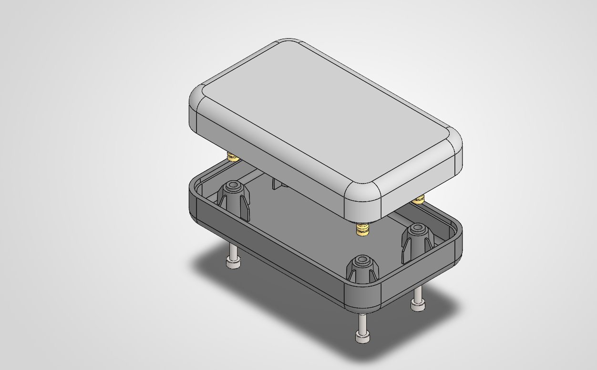
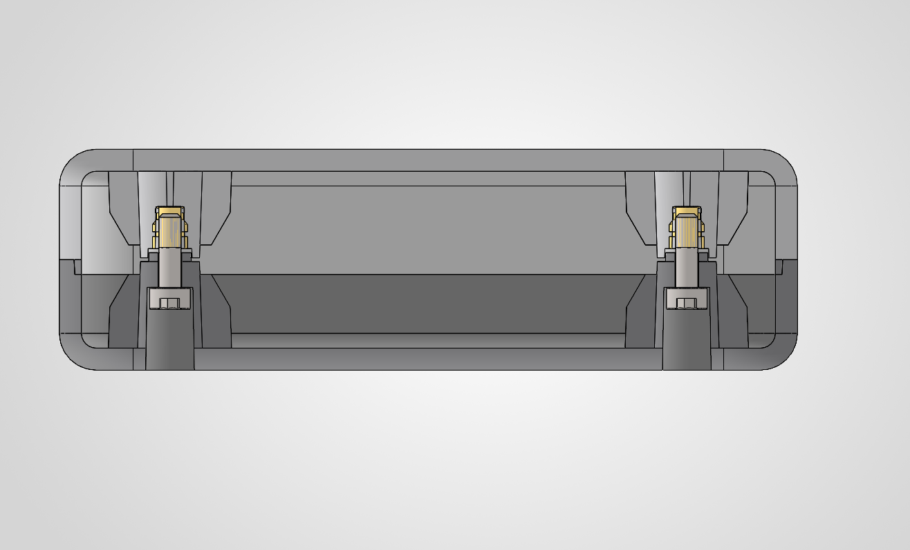

# Precision Two-Piece Electronic Enclosure (DFM & Fastening Architecture)

## 1. Executive Summary & Project Goals
The objective of this project was to design an injection-molded, two-piece electronic enclosure engineered for high serviceability, aesthetic surface flushness, and high-volume manufacturing (DFM). 

* **Overall Envelope:** 100.0 mm × 60.0 mm × 30.0 mm
* **Wall Thickness:** 3.0 mm (Uniform nominal wall)
* **Target Material:** PC/ABS Blend (SABIC Cycoloy C2950, UL 94 V-0)
* **Fastening Standard:** M3 × 10 mm Socket Head Fasteners (ISO 4762) engaging into ultrasonic/heat-set brass inserts (DIN 16903 / McMaster 94459A140).
* **Target Industry Standards:** DIN 16742 - TG6 (Plastics Tooling Tolerances), ISO 2768-mK, ISO 14583 / ISO 4762.

---

## 2. Design for Injection Molding (DFM) Considerations

### 2.1 Uniform Wall Thickness & Sink Mark Mitigation
* **Nominal Wall:** Maintained at a continuous 3.00 mm (±0.10 mm) throughout both shells to ensure balanced mold filling and uniform cooling rates.
* **Rib / Fin Proportions:** The four boss reinforcement fins are sized at **1.0 mm thickness**, which represents **33% of the nominal wall thickness** ($1.0 / 3.0 = 0.33$). 
  * *OEM Guideline:* Ribs must remain between 40%–60% of nominal wall to eliminate cosmetic sink marks on Class-A exterior surfaces. Our 33% design provides extreme rigidity while completely eliminating exterior sink marks.

### 2.2 Tooling Draft & Demolding Angles
* **Exterior / Cosmetic Walls:** Drafted at **1.0° to 2.0°** to accommodate light EDM spark erosion surface texture (**VDI 3400 Ref. 24**).
* **Boss Outer Walls:** Drafted at **2.0°** to allow rapid part ejection off the core plate without scuffing.
* **Insert Receiving Holes:** Modeled with minimal draft (**0.5°**) to guarantee vertical perpendicularity during automated heat-staking.

---

## 3. Fastener Architecture & Material Selection

### 3.1 Fastening Method Selection: Threaded Inserts vs. Self-Tapping
* Direct self-tapping screws (e.g., EJOT PT®) were evaluated but dismissed in favor of **Heat-Staked Brass Threaded Inserts (CuZn39Pb3 / C36000)** because the device specification mandates frequent technician maintenance (opening/closing > 50 cycles). 

### 3.2 Galvanic & Galling Mitigation
* **Fastener:** 18-8 Stainless Steel Socket Head Cap Screw (ISO 4762 / McMaster 91292A113).
* **Insert:** Brass Alloy 360 (McMaster 94459A140).
* *Engineering Rationale:* Austenitic stainless steel screws paired with stainless steel inserts carry a high risk of **thread galling (cold-welding)** under preload. Pairing **Stainless Steel with Brass** provides dissimilar metal contact with a low friction coefficient, preventing thread binding without secondary thread lubricants.

---

## 4. Problem-Solving & Stack-Up Optimization

### 4.1 Boss Step Clearance & Flush Parting Line
During initial prototyping, a dimensional overlap between the male alignment collar and female pocket prevented the perimeter Lip & Groove parting line from seating flush.

| Feature | Initial Value | Optimized Value | Engineering Purpose |
| :--- | :--- | :--- | :--- |
| **Male Collar OD (Bottom Cover)** | Ø 6.20 mm | **Ø 5.70 mm** | Provides 0.30 mm total radial clearance |
| **Female Pocket ID (Top Cover)** | Ø 5.00 mm | **Ø 6.00 mm** | Accommodates tool draft & thermal shrinkage |
| **Male Collar Height** | 1.50 mm | **1.20 mm** | Prevents axial bottoming-out |
| **Female Pocket Depth** | 1.50 mm | **1.50 mm** | **0.30 mm axial safety clearance** ensures 100% clamping force on outer parting line |

### 4.2 Fastener Length Stack-Up
* **Bottom Counterbore Depth:** 3.50 mm (Recesses the 3.0 mm socket head 0.5 mm sub-flush).
* **Clamping Boss Web Thickness:** $12.00\text{ mm} - 3.50\text{ mm} = 8.50\text{ mm}$.
* **Insert Installed Depth:** 5.70 mm.
* **Screw Length Selected:** **M3 × 10 mm**.
  * Thread engagement $= 4.50\text{ mm}$ ($\approx 1.5 \times D$).
  * Achieves maximum mechanical tensile pull-out resistance without piercing the top shell roof.

---

## 5. Manufacturing Documentation Package

The project includes full ISO/DIN-compliant production drawing packages:

1. **`ENC-ASM-001` (General Assembly & BOM):**
   * Isometric exploded view with balloon callouts (Items 1–4).
   * Fully structured Bill of Materials with supplier part numbers and material specs.
   * Internal section view detailing fastener clamp condition.
   * Assembly torque specification: **0.60 N·m ± 0.05 N·m**.
2. **`Top_Cover` (Injection Mold Tooling Drawing):**
   * Cavity view, core section, and Scale 4:1 detail of female insert pocket.
   * Includes lead-in chamfer for insert self-alignment ($0.4\text{ mm} \times 45^\circ$).
3. **`Bottom_Cover` (Injection Mold Tooling Drawing):**
   * Core section, counterbore depth callout, and Scale 4:1 detail of alignment collar.
